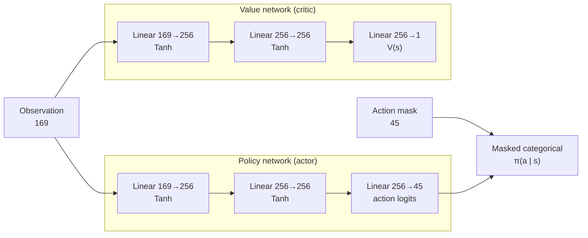

# RL agent

Source document for the thesis method chapter. It describes the RL agent exactly as
the code implements it today, and it is a living document: every change to the
observation, actions, reward, network, hyperparameters or training setup updates
this file in the same PR (see [Change log](#change-log)).

Vocabulary follows [`CONTEXT.md`](../CONTEXT.md). Decisions: ADR-0002 (RL v2
architecture), ADR-0003 (environment first, frozen at **env-v1**), ADR-0004 (fixed
mirror deck).

## Status

| | |
|---|---|
| Documented layout | 169-dim observation, 45 actions (11 deploy zones) |
| Simulation | env-v1: 8-card Deck, air units and splash; crowns decide the match; double elixir from 2:00, overtime and a weakest-tower tiebreak. Playtested ([checklist](playtest-env-v1.md)); frozen at the `env-v1` tag after the user's sign-off |
| Trained model for this layout | none yet; the **v2 model** is trained only after env-v1 is tagged (ADR-0003) |
| **v1 model** | historical result only (13 actions); cannot run in env-v1, see [Results](#results) |

The observation and action layout above is the env-v1 contract: it is pinned by
`tests/test_env_layout.py`, and any change to it needs a new environment version.

## Agent at a glance

- **Algorithm:** MaskablePPO (`sb3-contrib`), PPO with invalid-action masking.
- **Learner:** player 0 (bottom half of the arena). The opponent plays player 1.
- **Training opponent:** the rule-based bot (`LogicAgent`); the curriculum
  experiment starts against the random bot (`RandomAgent`).
- **Decision rate:** one action per simulation tick, 10 Hz (`TICK_DT = 0.1` s).
- **Episode:** one match, at most 3001 steps (180 s regulation + 120 s overtime).

Code: `src/cr_rl/game/board.py` (observation, actions, mask, reward),
`src/cr_rl/env/gym_env.py` (Gymnasium wrapper), `src/cr_rl/training/train.py`
(training and evaluation), `src/cr_rl/agents/rl.py` (inference).

## Environment interface

`ClashRoyaleEnv` wraps `Board` as a Gymnasium environment with
`observation_space = Box(-1, 1, (169,), float32)` and `action_space = Discrete(45)`,
and exposes `action_masks()` for MaskablePPO.

One `step(action)`:

1. The opponent picks its action for player 1 (the rule-based bot submits its play
   through `set_pending_play` and returns noop).
2. Player 0's action is applied, then player 1's.
3. Elixir regenerates for both players (start 5, max 10, +1 per 2.8 s; twice as fast from 2:00 through overtime).
4. Combat runs for one tick; the reward is computed from the tower-HP change.
5. Dead units are removed and the clock advances by 0.1 s.
6. End check: **terminated** when a king tower is destroyed (3 crowns for its
   destroyer). Otherwise nothing happens before 180 s; then **truncated** as soon as the
   crowns differ (end of regulation, or the first crown of the up-to-120 s overtime), so the
   player with more crowns wins (a princess tower is 1 crown). Tied crowns at 180 s start
   overtime; if it ends without a crown, the player whose weakest standing tower has less
   HP loses and equal weakest towers are a draw. 1800 ticks of 0.1 s accumulate to just
   under 180.0 in floating point, so a regulation match lasts 1801 steps.

When the match ends, `info["winner"]` holds the winner (0 or 1) or `None` for a draw;
it is `None` on every earlier step.

## Observation

A flat `float32` vector of `OBS_DIM = 169` features, built by
`Board.get_observation(player)`. Segment offsets are named constants in `board.py`
(`OBS_GLOBAL_FEATURES`, `OBS_TOWER_FEATURES`, `OBS_HAND_BASE`, `OBS_NEXT_BASE`, `OBS_UNIT_BASE`, …).
No `VecNormalize` is applied; every feature is already scaled to [-1, 1].

| Indices | Count | Feature | Encoding |
|---|---|---|---|
| 0 | 1 | Own elixir | `elixir / 10` |
| 1 | 1 | Enemy elixir | `elixir / 10` (visible, unlike the real game) |
| 2 | 1 | Match time | `min(1, time / 180)` (stays 1 during overtime) |
| 3–5 | 3 | Own towers: left princess, right princess, king | `hp / max_hp`; 0 once destroyed |
| 6–8 | 3 | Enemy towers: left princess, right princess, king | `hp / max_hp`; 0 once destroyed |
| 9–40 | 32 | Hand: 4 slots × 8 cards | one-hot per slot |
| 41–48 | 8 | Next card | one-hot over the 8 Deck cards |
| 49–168 | 120 | Units: 24 slots × 5 features | see below |

**Hand.** Slot `s` occupies indices `9 + 8·s … 16 + 8·s`; the hot index is the
card ID in Deck order: Knight 0, Giant 1, Hog Rider 2, Musketeer 3, Cannon 4,
Fireball 5, Arrows 6, Baby Dragon 7. The hand is always full (4 cards). Slots are
positional: playing the card in slot `s` shifts slots `s+1…3` down by one and the
drawn card lands in slot 3.

**Next card.** Indices `41 … 48` hold the one-hot of the visible next card, the card
drawn after the next play (the Cycle's queue head). The rest of the queue and the
enemy hand are not observed; the queue follows from the Cycle since each played card
goes to its back.

**Units.** Every living troop and building on the board (both players, towers
excluded), sorted by distance to the observer's **enemy** king tower, nearest first,
truncated to 24. Slot `k` occupies indices `49 + 5·k … 53 + 5·k`:

| Offset | Feature | Encoding |
|---|---|---|
| +0 | Owner | +1 own, −1 enemy, 0 empty slot |
| +1 | Card | `card_id / 7` (Knight 0.0, Giant 1/7, Hog Rider 2/7, Musketeer 3/7, Cannon 4/7, Baby Dragon 1.0) |
| +2 | x position | `x / 18` |
| +3 | y position | `y / 32` |
| +4 | Health | `hp / max_hp` |

Unit attack cooldown, deploy state, remaining Cannon lifetime, whether a unit flies and
spell effects are not observed (a flying unit is identified by its card).

**Player 1 view.** For `player = 1` the vector is built from player 1's perspective,
so a policy trained as player 0 can drive player 1: own elixir first, own towers
first, own hand, and unit positions rotated by 180° (`x' = 18 − x`, `y' = 32 − y`).
See [Known limitations](#known-limitations) for where this view and the action
layout disagree.

## Actions

`NUM_ACTIONS = 45 = 1 + 4 hand slots × 11 deploy zones`.

| Action | Meaning |
|---|---|
| 0 | noop (always legal) |
| 1–44 | play the card in hand slot `s` at zone `z`, where `s, z = divmod(action − 1, 11)` |

So actions 1–11 are slot 0 at zones 0–10, actions 12–22 are slot 1, and so on. For
the agent each **deploy zone** is a single fixed placement point (ADR-0002); humans
in the web client place at continuous coordinates. Player 0 coordinates; for player 1
the y coordinate is mirrored (`y → 32 − y`):

| Zone | Name | (x, y) | Accepts | Purpose |
|---|---|---|---|---|
| 0 | back-L | (3.0, 4.5) | troops, buildings | slow buildup behind the towers |
| 1 | back-R | (14.0, 4.5) | troops, buildings | |
| 2 | mid-L | (3.0, 9.0) | troops, buildings | standard lane play |
| 3 | mid-R | (14.0, 9.0) | troops, buildings | |
| 4 | bridge-L | (3.0, 14.0) | troops, buildings | bridge pressure |
| 5 | bridge-R | (14.0, 14.0) | troops, buildings | |
| 6 | pull-L | (5.5, 9.5) | troops, buildings | **pull zone** for building-targeters |
| 7 | pull-R | (12.5, 9.5) | troops, buildings | |
| 8 | spell-tower-L | (3.5, 24.0) | spells | **spell zone** on the left enemy princess tower |
| 9 | spell-tower-R | (14.5, 24.0) | spells | right enemy princess tower |
| 10 | spell-king | (9.0, 30.0) | spells | enemy king tower |

The pull-zone placement is derived in ADR-0002: a Cannon at pull-L is closer to an
enemy Hog Rider leaving the left bridge than the princess tower is.

### Action masking

`Board.valid_action_mask(player)` returns a 45-element boolean mask. Noop is always
legal; play `(s, z)` is legal when the player can afford the card in slot `s` and
zone `z` accepts that card type (troop/building zones 0–7, spell zones 8–10). With
the Deck a troop or building (Baby Dragon included) has 8 legal zones and each of
Fireball and Arrows has 3, so at most 33 of the 45 actions are legal at once.

The mask is applied during training (the env is wrapped in `ActionMasker`), during
evaluation and in-game inference (`model.predict(..., action_masks=mask)`).
MaskablePPO sets the logits of masked actions to a large negative value before the
softmax, so they get zero probability, contribute nothing to the policy gradient, and
are excluded from the entropy. The agent therefore never spends samples on illegal
plays.

## Reward

The reward is the per-step change in tower HP, from player 0's perspective:

```
r_t = (enemy_tower_hp_lost_t − own_tower_hp_lost_t) / MAX_TOWER_HP_PER_PLAYER
```

with `MAX_TOWER_HP_PER_PLAYER = 2 × 3052 + 4824 = 10928` (one player's total tower
HP). There is no shaping and no terminal win/loss bonus, so the episode return is the
net tower damage as a fraction of one player's total tower HP, bounded by [-1, 1].

Destroying the king tower ends the match, so the return reflects the result only
through HP: a narrow total-HP win at the time limit and a king-tower win can yield
similar returns. The reward is sparse, being zero on every tick without tower damage;
ADR-0002 plans shaped auxiliaries (troop trade value, elixir-leak penalty, kill/loss
delta) for v2.

## Network architecture

`MlpPolicy` of MaskablePPO with `net_arch = dict(pi=[256, 256], vf=[256, 256])`:
separate policy and value networks with no shared layers, Tanh activations, and
orthogonal initialization (SB3 defaults).



| Part | Parameters |
|---|---|
| Policy MLP (169→256→256) | 109,312 |
| Value MLP (169→256→256) | 109,312 |
| Action head (256→45) | 11,565 |
| Value head (256→1) | 257 |
| **Total** | **230,446** |

A flat MLP fits the problem size: the observation is small and fixed-length, and the
network is small enough to train on a laptop CPU (ADR-0002 keeps it for v2).
Separate networks keep the value loss from distorting the policy features, which
matters because the value target, the net tower damage, is noisy and mostly zero.

## PPO hyperparameters

Values are the defaults of `train()` in `src/cr_rl/training/train.py`; the v1 model
was trained with the same values.

| Parameter | Value | Rationale |
|---|---|---|
| `learning_rate` | 3e-4, constant | Standard Adam step size for PPO (SB3 default); the sweep tests 1e-4 and 1e-3. |
| `n_envs` | 8 | Eight environments with different seeds decorrelate the samples in a rollout. They run sequentially in one process (`DummyVecEnv`), so this buys sample diversity, not speed. |
| `n_steps` (per env) | `max(2048 // n_envs, 256)` = 256 | A rollout of 2048 transitions (the PPO default size), with a floor of 256 steps (25.6 s of match time) per environment so each segment is longer than the discount horizon. |
| `batch_size` | 256 | 8 minibatches per epoch over the 2048-transition rollout: enough gradient steps per rollout while each minibatch still spans several environments and game phases. |
| `n_epochs` | 10 | SB3 default. Simulation steps are the expensive part, so each rollout is reused for 10 passes; the clipped objective keeps that reuse from moving the policy too far. |
| `gamma` | 0.995 | A play pays off only when units reach a tower: a Giant from back-L walks about 15 s (150 ticks) to the enemy princess tower. At 10 Hz, γ = 0.995 gives an effective horizon of 1/(1−γ) = 200 ticks (20 s) and a half-life of about 14 s; the default 0.99 (100 ticks, 7 s half-life) would discount a slow push nearly to zero. |
| `gae_lambda` | 0.95 | SB3 default. Advantages still credit rewards a few seconds after the action (λγ = 0.945 per tick) while damping the variance of the noisy tower-damage returns. |
| `clip_range` | 0.2 | SB3 default. Limits each update to a ±20% change in action probabilities, which keeps the rare card-play actions from being suppressed by one bad rollout. |
| `ent_coef` | 0.02 | SB3 uses 0. Noop is legal on every tick and right most of the time, so without an entropy bonus the policy tends to collapse to waiting early; 0.02 keeps card plays explored. The sweep tests 0.005 and 0.05. |
| `vf_coef` | 0.5 | SB3 default. With separate networks it only scales the value loss against the policy loss in the shared Adam step. |
| `max_grad_norm` | 0.5 | SB3 default. Clips the rare large gradients from steps where a tower falls and the reward spikes. |
| `net_arch` | pi [256, 256], vf [256, 256] | See [Network architecture](#network-architecture); the sweep tests 128 and 512 units. |
| `total_timesteps` | 1,000,000 | About 555 full-length matches; small enough that several variants fit a laptop budget. |
| `seed` | 42 | Fixed for reproducibility; environment `i` uses seed `42 + i`. |

## Training setup

`cr-rl-train` (`train()`):

- **Environments:** 8 × `ClashRoyaleEnv(opponent="logic")` wrapped in `ActionMasker`,
  vectorized with `DummyVecEnv`; seeds `42 … 49`.
- **Evaluation callback:** `MaskableEvalCallback` every 25,000 steps on a separate
  environment (seed 10,042): 50 deterministic episodes vs the rule-based bot. The best
  mean reward is saved to `models/best_model.zip` and copied to
  `models/ppo_cr_best.zip`, the path the game loads by default.
- **Checkpoints:** every 100,000 steps to `models/checkpoints/`; the final model goes
  to `models/ppo_cr_final.zip`.
- **Logging:** TensorBoard in `models/tb/`, including `rollout/win_rate_vs_logic`
  (player 0 win rate over the last 200 decisive matches, draws skipped, logged every
  5,000 steps).
- **CLI:** `--timesteps`, `--n-envs`, `--seed`, `--lr`, `--resume`, and
  `--eval-only MODEL.zip --eval-episodes N`.

**Seeding and determinism.** The board seed only shuffles the starting card order; the
simulation and the rule-based bot are deterministic. A `ClashRoyaleEnv` built with a
seed reuses that seed on every reset, so each training environment replays the same
opening hand every episode. Against the rule-based bot, episodes differ only through
the stochastic policy; against the random bot (curriculum phase 1), its unreseeded RNG
adds variation.
See [Known limitations](#known-limitations).

**Experiments** (`src/cr_rl/experiments/`, results under `experiment_runs/`):

- `cr-rl-sweep`: one training run per configuration (`baseline`, `low_lr`,
  `high_lr`, `high_entropy`, `low_entropy`, `gamma_99`, `big_net`, `small_net`), each
  evaluated vs the rule-based bot.
- `cr-rl-curriculum`: phase 1 against the random bot (default 300k steps), phase 2
  against the rule-based bot (default 700k steps), same hyperparameters.

No sweep or curriculum results are committed yet.

### Evaluation

`evaluate_model()` (`cr-rl-evaluate`, `cr-rl-train --eval-only`) plays N matches as
player 0 vs the rule-based bot with the deterministic policy and seeds
`seed, seed + 1, …, seed + N − 1`, and reports wins, losses, draws, win rate, mean
return and mean match length.

The protocol for the v2 model (ADR-0002, amended by ADR-0003): fixed seeds,
200 matches vs the rule-based bot and 200 vs the random bot, reporting win rate, mean
return and match length. The v1 model is not part of that comparison.

## Results

### v1 model (historical)

The **v1 model** was trained on the pre-env-v1 game (commit `de8d9f4`, June 2026)
with the hyperparameters above for about 1,000,000 steps (SB3 finishes the last
2048-step rollout, so roughly 1,001,472). It cannot run in env-v1 or in the
current 45-action layout (ADR-0003). It is kept as a historical result, not as a
comparison point for v2.

Differences from the current game and layout:

- 3 deploy zones per player, (3, 6), (9, 6) and (14, 6) for player 0, giving 13
  actions. There were no dedicated building or spell zones: `play_card` moved a
  building to y = 11 (5 tiles from the river) and cast a spell at the zone mirrored
  onto the enemy side, e.g. (3, 26).
- The mask filtered by elixir only: every zone was legal for any affordable card.
- Units walked L-shaped paths to the bridges; diagonal bridge-bank pathing came later
  (ADR-0001), which changed the dynamics the v1 model was trained on.
- The player 0 observation (153 features: the 6-card layout without a next card) and
  the reward were the same as then; the player 1 view was not mirrored yet.

Evaluation recorded in [`docs/thesis/ocena.ipynb`](thesis/ocena.ipynb): 30 matches as
player 0 vs the rule-based bot, seeds 0–29, deterministic policy.

| Agent | Wins | Losses | Draws | Win rate | Mean return | Mean length |
|---|---|---|---|---|---|---|
| v1 model, final weights (1M steps) | 21 | 9 | 0 | **70.0%** | 0.065 | 1801 |
| v1 model, eval-callback best (650k steps) | 2 | 28 | 0 | 6.7% | −0.201 | 1794 |
| `RLAgent` without weights (random legal action on 50% of ticks; not the random bot) | 14 | 16 | 0 | 46.7% | −0.056 | 1801 |
| Rule-based bot vs random bot (50 matches) | 50 | 0 | 0 | 100.0% | — | 1051 |

How to read the result:

- The final weights' mean length of 1801 is the maximum, so every one of its 30
  matches ran to the time limit: all 21 wins are total-tower-HP wins, none a
  king-tower win.
- `RLAgent` without weights, playing random legal actions, already wins 46.7% against
  the rule-based bot, so 70% is a moderate improvement over chance-level play, from a
  small sample (30 matches).
- The training-time win rate (`rollout/win_rate_vs_logic`) ended at 25.5% (peak
  28%). It measures the stochastic policy on the 8 fixed training seeds, while the 70%
  is the deterministic policy on 30 other seeds.
- The eval-callback "best" model performed far worse than the final weights because
  every one of its 50 evaluation episodes was the same match (see
  [Known limitations](#known-limitations)), so "best" was picked on a single match.

The model files currently in `models/` come from a later run on the same v1 layout
(2,000,896 steps, August 2026) that has no recorded evaluation. They are not the
weights behind the 70% result.

### v2 model

Not trained yet. It is trained on env-v1 and evaluated against the rule-based and
random bots under the protocol above.

## Known limitations

Facts about the current code that the v2 work should address:

- **Player 1 lane mismatch.** The player 1 observation rotates unit positions by 180°
  (left and right swap), but player 1's deploy zones mirror only y (left stays left)
  and the tower features keep the left/right order. A policy trained as player 0 and
  run as player 1, which is how the RL opponent plays in the web game, sees its unit
  in one lane after choosing a zone in the other.
- **Fixed seed per environment.** Each training environment replays one opening
  hand, so the agent trains on only 8 distinct openings.
- **Degenerate evaluation callback.** The evaluation environment also reuses its seed,
  and both the policy (deterministic) and the rule-based bot are deterministic, so all
  50 episodes of every evaluation are identical (verified in
  `models/eval/evaluations.npz`: 80 of 80 evaluations). Model selection by
  `ppo_cr_best.zip` is therefore unreliable.
- **Sparse, HP-only reward.** No signal for trades, elixir efficiency or winning
  itself; see [Reward](#reward).
- **Partial observation.** No queue beyond the next card, no unit cooldown or deploy
  state, and opponent elixir is visible.

## Change log

| Date | Change |
|---|---|
| 2026-10-17 | First version: documents the 45-action / 11-zone layout and records the v1 model as a historical result. |
| 2026-10-17 | Card stats moved to `card_stats.json` at tournament standard (level 11); tower HP, and so `MAX_TOWER_HP_PER_PLAYER`, changed from 15880 to 10928. |
| 2026-10-17 | Deck of 8 (Knight, Giant, Hog Rider, Musketeer, Cannon, Fireball, Arrows, Baby Dragon) with air units and splash (#19): `OBS_DIM` 153 → 169 (hand one-hot 4×8, new next-card one-hot, card IDs in Deck order), action space unchanged at 45. v1 and 153-dim checkpoints are ignored at load. |
| 2026-10-17 | The win rule counts crowns instead of comparing total tower HP at the time limit; the reward is unchanged. |
| 2026-10-17 | env-v1 playtest ([checklist](playtest-env-v1.md)): troops and buildings can no longer be placed in the river water (the deploy region ends at the bank, `RIVER_Y ∓ 1.2`); the 11 deploy zones, the 45 actions and the 169-dim observation are unchanged and pinned by `tests/test_env_layout.py`. |
